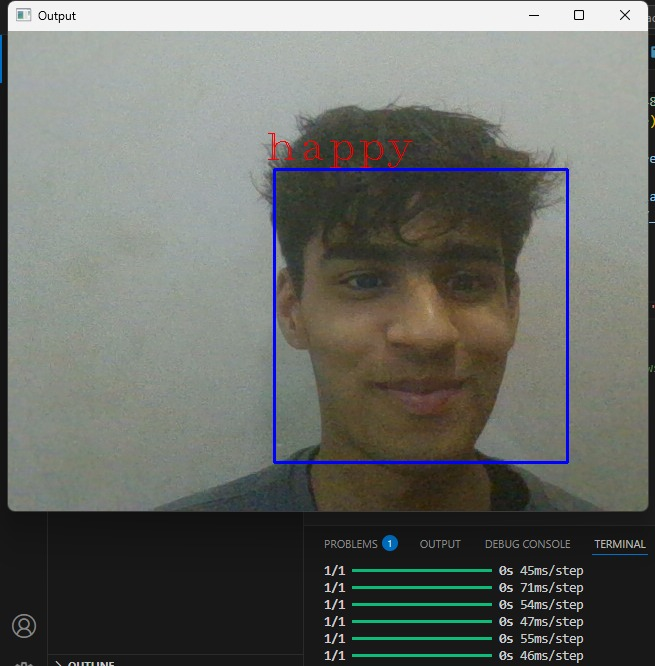

# Facial Emotion Recognition

Real-time facial emotion recognition from a webcam. A CNN trained on 48×48 grayscale face images labels each detected face as one of seven emotions: **angry, disgust, fear, happy, neutral, sad, surprise**.



## How it works

1. **Face detection**: OpenCV's Haar cascade (`haarcascade_frontalface_default.xml`) finds faces in each webcam frame.
2. **Preprocessing**: each face is cropped, converted to grayscale, resized to 48×48 and normalised to `[0, 1]`.
3. **Classification**: a Keras CNN predicts the emotion, which is drawn above the face's bounding box.

### Model

| Layer block | Details |
|---|---|
| Conv blocks ×4 | Conv2D (128 → 256 → 512 → 512 filters, 3×3, ReLU) + MaxPool 2×2 + Dropout 0.4 |
| Dense | 512 (ReLU, Dropout 0.4) → 256 (ReLU, Dropout 0.3) |
| Output | 7-way softmax |

Trained with Adam and categorical cross-entropy on ~28.8k training and ~7k test images (FER-style dataset, one folder per emotion), batch size 128.

## Project structure

```
drs model.ipynb        # training notebook: load data, build CNN, train, save
realtimeworking.py     # live webcam inference
emotiondetector.json   # model architecture
emotiondetector.h5     # trained weights
images/train, images/test   # dataset, one sub-folder per emotion
```

## Run it

```bash
git clone https://github.com/Ron2509/Facial-emotion-Recognition.git
cd Facial-emotion-Recognition
python -m venv .venv
.venv\Scripts\activate          # macOS/Linux: source .venv/bin/activate
pip install -r requirements.txt
python realtimeworking.py
```

A window opens with your webcam feed and the predicted emotion above each face. Press **`s`** to quit.

To retrain, open `drs model.ipynb` in Jupyter and run all cells. It reads from `images/train` and `images/test` and overwrites `emotiondetector.json` / `emotiondetector.h5`.

## Tech stack

Python · TensorFlow / Keras · OpenCV · NumPy · pandas · scikit-learn · Jupyter
